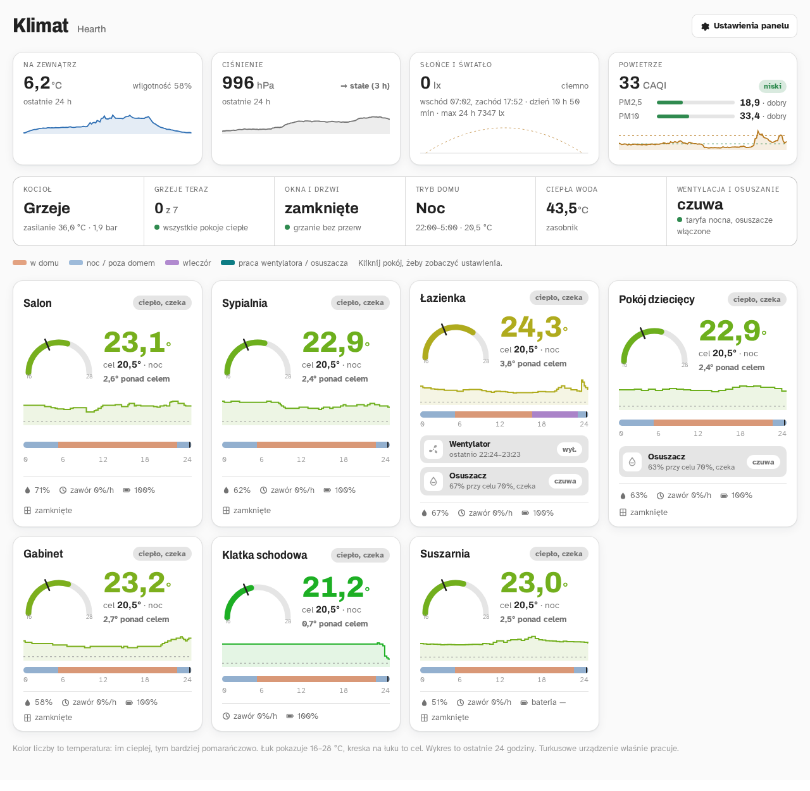
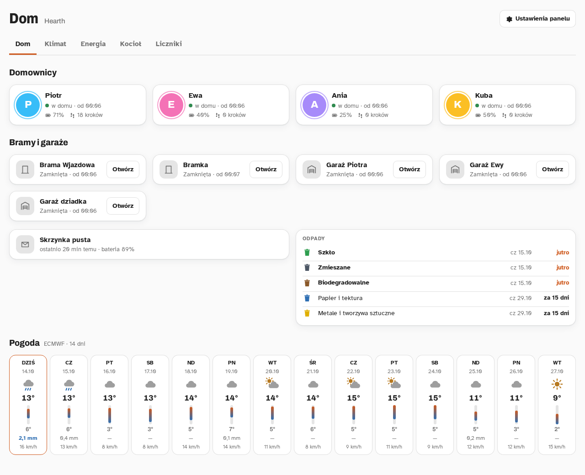
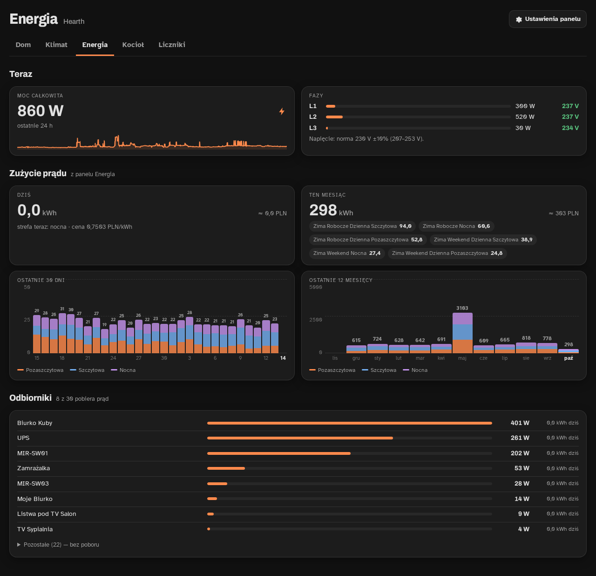
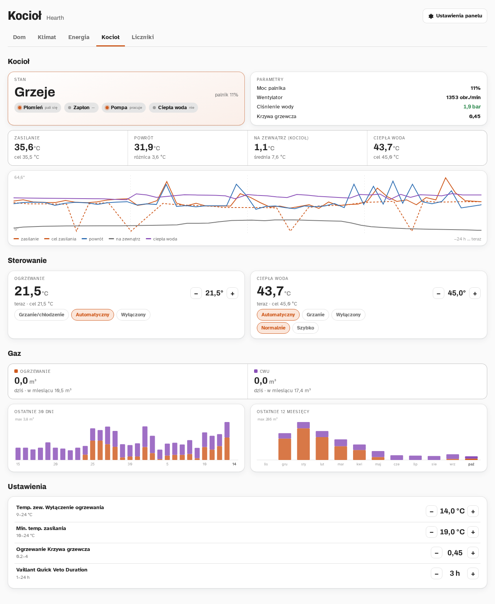
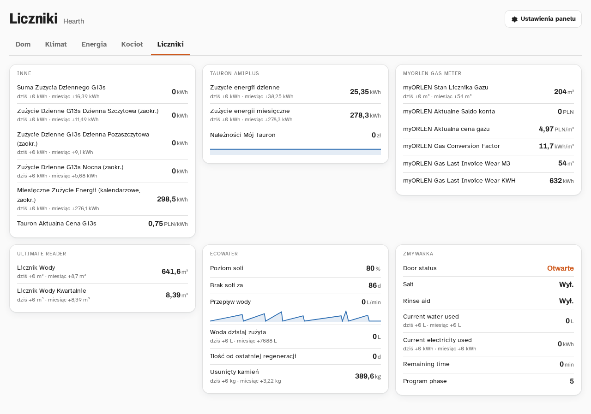
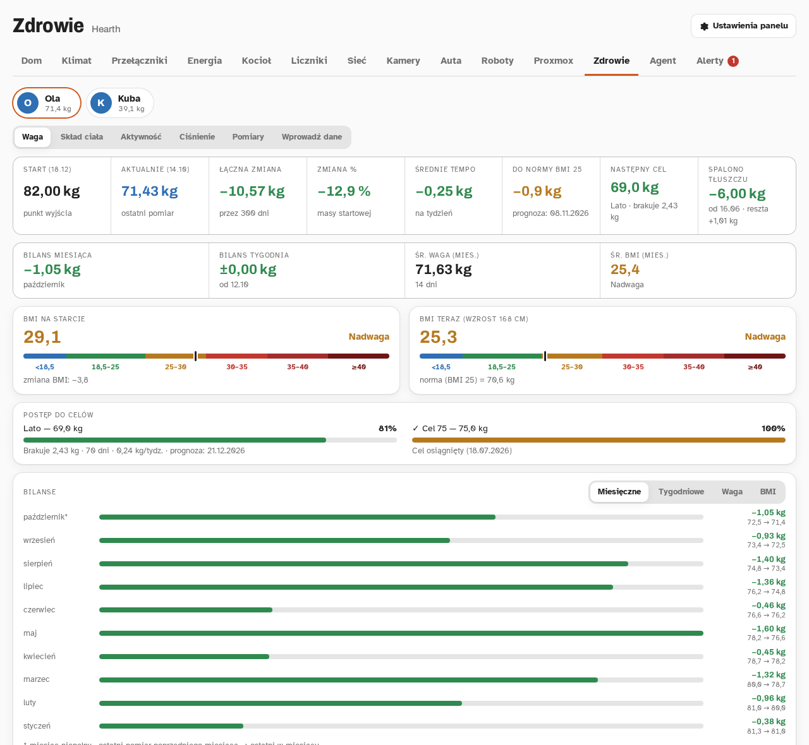
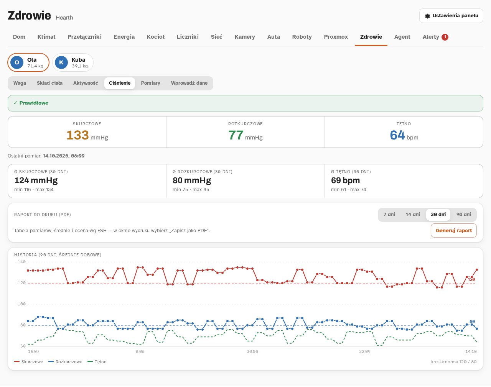
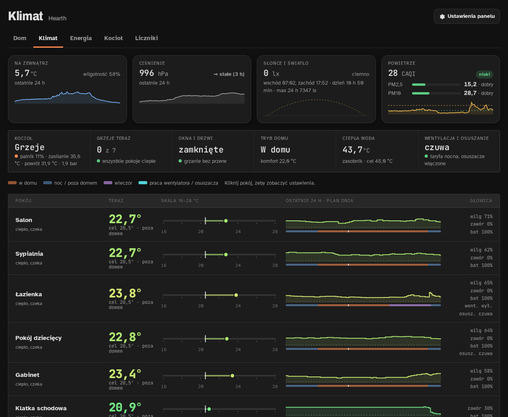
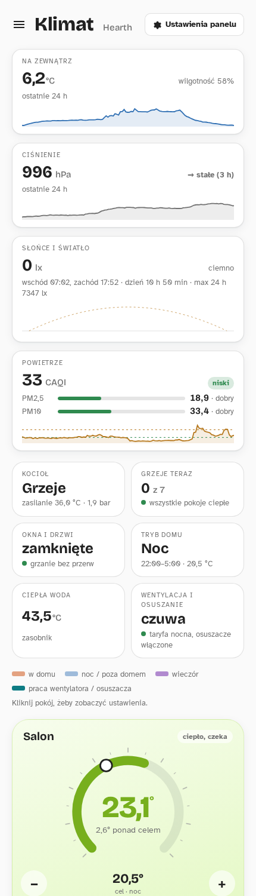

# Hearth

<p align="center">
  
</p>

[](https://github.com/keysim86/ha-hearth/releases/latest)
[](https://github.com/keysim86/ha-hearth)
[](https://www.home-assistant.io/)
[](LICENSE)

> Panel Home Assistant dla całego domu: **Dom**, **Klimat**, **Przełączniki**, **Energia**, **Kocioł**, **Liczniki**, **Sieć**,
> **Kamery**, **Auta**, **Roboty**, **Proxmox**, **Zdrowie**, **AGD**, **Agent** i **Alerty** — każdą zakładkę włączasz i ustawiasz w kolejności w opcjach.
> Pokoje budują się same z **obszarów HA**, zużycie z **panelu Energia** HA — bez list encji w YAML-u.



## Zakładki

| Zakładka | Zawartość |
|-------|-----------|
| 🏠 **Dom** | Domownicy (zdjęcie, gdzie są i od kiedy, odległość, bateria telefonu, kroki; kliknięcie = mapa) · bramy i garaże z przyciskiem i czasem otwarcia · skrzynka pocztowa · odpady z kalendarza (tylko frakcje z terminem, przełączniki frakcji) · pogoda: prognoza ECMWF 14 dni, radar opadów RainViewer, Windy |
| 🌡️ **Klimat** | Na zewnątrz (temperatura, ciśnienie z trendem, słońce i światło, CAQI, PM2,5/PM10 wg GIOŚ) · pasek domu · pokoje: temperatura i cel, wykres 24 h, oś dnia, wentylatory i osuszacze · po kliknięciu ustawienia pokoju (profile −/+, automatyka, osuszacz, wentylator, pomocniki obszaru: progi −/+ i przełączniki) |
| ⚡ **Energia** | Moc całkowita z wykresem 24 h · fazy L1–L3 z kontrolą napięcia · zużycie dziś i w miesiącu ze źródeł panelu Energia, z podziałem na strefy i kosztem · 30 dni i 12 miesięcy w strefach, z etykietami i podpowiedzią · ranking odbiorników (moc teraz, kWh dziś) |
| 🔥 **Kocioł** | Stan (płomień, zapłon, pompa, ciepła woda), moc palnika, wentylator, ciśnienie, krzywa · zasilanie, powrót, zewnątrz, ciepła woda z wykresem 24 h i podpowiedzią · termostaty ogrzewania i ciepłej wody (tryby, presety, −/+, Quick Veto przez ebusd) · harmonogramy ogrzewania, ciepłej wody i cyrkulacji ze sterownika (ebusd) z edycją · gaz: dziś, miesiąc, 30 dni, 12 miesięcy, lata · suwaki ustawień |
| 🔌 **Przełączniki** | Światła, gniazdka i wentylatory według pokoi (obszary HA), czas włączenia, moc, wyszukiwarka |
| 🌐 **Sieć** | Prędkość internetu z wykresem, łącza z dostępnością i przerwami, aktualizacje, porty i PoE |
| 📹 **Kamery** | Podglądy co 5 s, kliknięcie = obraz na żywo, stan rejestratora i magazynu |
| 🚗 **Auta** · 🤖 **Roboty** | Paliwo, zasięg, przebieg, akumulator, zamek, mapa · kosiarki i odkurzacze: stan, bateria, mapa, przyciski |
| 🖥️ **Proxmox** | Węzeł, magazyny, maszyny i kontenery (CPU, RAM, dysk) z uruchamianiem i restartem · realny RAM maszyn z czujnika `sensor.<maszyna>_ram_zajeta` (z wnętrza systemu), gdy jest — Proxmox podaje dla VM pamięć przydzieloną |
| ❤️ **Zdrowie** | Osoby z ustawień integracji · waga: start, zmiana, tempo, BMI z paskiem, cele z prognozą, bilanse miesięczne i tygodniowe, historia z trendem 7 dni · skład ciała (tłuszcz wg progów ACE, masa beztłuszczowa, mięśnie, woda) · aktywność: kroki i kalorie dziś i w 7–90 dniach · ciśnienie: wartości, średnie z pomiarów, historia 90 dni, raport do druku / PDF · pomiary obwodów (profil, bilans, historia) · siatki centylowe WHO dla dzieci · wpis obwodów do pomocników |
| 🧊 **AGD** | Karta na urządzenie, wykrywana po integracji · lodówka (Home Connect): temperatury chłodziarki i zamrażarki z −/+, drzwi, alarmy, tryby (urlopowy i szabatowy z potwierdzeniem), światło; zasilania nie da się stąd wyłączyć · zmywarka (hOn): czas do końca i godzina zakończenia, program, sól, nabłyszczacz, błąd · uzdatniacz (EcoWater): sól w % i na ile dni, woda dziś i średnio, przepływ, zapas do regeneracji, ostatnia regeneracja · inne urządzenia tych integracji: odczyty |
| 🔔 **Alerty** · 🤖 **Agent** | Reguły z licznikiem na zakładce · dowolna strona w ramce |
| 📟 **Liczniki** | Dowolne encje pogrupowane według urządzeń (licznik, sprzedawca, zmiękczacz, zmywarka…) · liczniki narastające z zużyciem dziś i w miesiącu · pomiary z wykresem 24 h · stany drzwi, soli i daty po polsku |

<table><tr>
<td></td>
<td></td>
</tr><tr>
<td></td>
<td></td>
</tr><tr>
<td></td>
<td></td>
</tr></table>

### Trzy style kart pokoi

Styl domyślny wybierasz w opcjach integracji, a każde urządzenie (telefon, tablet, komputer) może mieć własny —
**Ustawienia panelu** (koło zębate w prawym górnym rogu).

| Kafelki (domyślny) | Lista | Pokrętła |
|---|---|---|
| Łuk 16–28 °C, wykres 24 h, oś dnia, urządzenia | Wiersz na pokój, skala z celem i pomiarem — najgęstszy, na komputer | Kolorowe karty jak termostat, − / + na karcie — na telefon i tablet |



<p align="center"></p>

## Instalacja

1. HACS → ⋮ → **Niestandardowe repozytoria** → `https://github.com/keysim86/ha-hearth`, typ **Integracja**.
2. Znajdź **Hearth** w HACS i pobierz.
3. Uruchom ponownie Home Assistanta.
4. **Ustawienia → Urządzenia i usługi → Dodaj integrację → Hearth.** Panel pojawi się w menu bocznym.

Przy dodawaniu Hearth sam podpowiada czujniki „na zewnątrz” (po nazwach typu *outdoor*, *zewn*, *air monitor*).
Resztę ustawiasz w **Konfiguruj** przy integracji.

## Jak powstają pokoje

Pokój to **obszar HA z termostatem** (encja `climate.*`). Do pokoju trafiają encje z tego obszaru — przypisane
wprost albo przez urządzenie:

| Element | Reguła |
|---|---|
| Termometr | czujnik temperatury z osobnego urządzenia, najlepiej tego z wilgotnością; bez niego — czujnik głowicy |
| Wilgotność | czujnik wilgotności z tego samego urządzenia co termometr |
| Okna i drzwi | `binary_sensor` klasy *window / door / opening* z małego urządzenia (kontaktron), więc drzwi zmywarki się nie liczą |
| Zawór, bateria | czujniki urządzenia głowicy (zawór tylko w %) |
| Osuszacz | `humidifier` klasy *dehumidifier*; moc i energia z tego samego urządzenia (np. gniazdka) |
| Wentylator | encje `fan.*`, przełączniki z „wentylator” / „fan” w nazwie albo wskazane w opcjach |
| Automatyka urządzeń | `input_number` i `input_boolean` przypisane do obszaru (poza profilami ogrzewania), np. progi wentylatora, „wymuś osuszacz” |

Coś trafiło nie tam? **Pomiń encje** w opcjach. Chcesz inne pokoje albo inną kolejność? **Pokoje (obszary)**.

## Opcje

Puste pole albo lista = panel wykrywa sam. Wpisujesz tylko wyjątki.

| Sekcja | Pola | Bez ustawień |
|---|---|---|
| **Wygląd** | styl kart, kolor wiodący (gotowy, kolor motywu HA albo `#rrggbb`), zakładki, nazwa i ikona w menu, tylko dla administratorów | wszystkie zakładki, kafelki, kolor Żar |
| **Na zewnątrz** | temperatura, wilgotność, ciśnienie, światło, PM2,5, PM10, indeks powietrza i jego poziom | podpowiedź przy dodaniu integracji |
| **Pasek domu** | obecność domowników, strefa taryfy | — |
| **Zakładka Dom** | osoby, bramy, skrzynka pocztowa (+ bateria), kalendarz odpadów albo czujniki, przełączniki frakcji, pogoda (encja) | osoby z telefonem, rolety klasy brama/garaż/drzwi, kalendarz Waste Collection Schedule, pomocniki z „odpad/waste”, Open-Meteo |
| **Zakładka Energia** | moc całkowita, moc i napięcie faz, odbiorniki | zużycie, koszty i odbiorniki z panelu Energia |
| **Kocioł** | termostaty ogrzewania i CWU, stan albo płomień + zapotrzebowanie na CWU, zapłon, pompa, moc, wentylator, zasilanie (+ cel), powrót, ciśnienie, krzywa, zewnątrz (+ średnia), ciepła woda (+ cel), gaz, suwaki ustawień · ebusd: temat strefy do Quick Veto, tryb specjalny, koniec Veto | gaz z panelu Energia; bez tematu ebusd zwykła nastawa |
| **Zakładka Liczniki** | encje liczników (grupowane według urządzeń) | woda i gaz z panelu Energia |
| **AGD** | pominięte urządzenia (Home Connect, hOn, EcoWater) | wszystkie wykryte |
| **Pokoje** | obszary i ich kolejność, prefiks pomocników ogrzewania, wentylatory, pominięte encje | każdy obszar z termostatem |

### Zdrowie — osoby

Osoby zakładki **Zdrowie** to podwpisy integracji: **Ustawienia → Urządzenia i usługi → Hearth → Dodaj osobę**
(zmiana: ⋮ przy osobie → Zmień dane osoby). Wymagane są tylko imię, płeć i czujnik wagi (kg, ze statystykami);
każda kolejna sekcja włącza swoją podstronę:

| Sekcja | Pola | Podstrona |
|---|---|---|
| **Osoba** | imię, osoba HA (zdjęcie), płeć, data urodzenia, waga, wzrost (encja w cm albo w m z telefonu, albo stały), waga i data startu, dni historii | Waga |
| **Skład ciała** | tkanka tłuszczowa %, masa tłuszczu, masa beztłuszczowa, tkanka beztłuszczowa, mięśnie szkieletowe, kości, woda, przemiana podstawowa | Skład ciała |
| **Aktywność** | kroki i kalorie dziś (liczniki zerowane o północy), cele | Aktywność |
| **Ciśnienie** | skurczowe, rozkurczowe, tętno, kategoria, imię i nazwisko oraz ciśnieniomierz do raportu, pominięte pomiary | Ciśnienie |
| **Pomiary ciała** | obwody: szyja, klatka, brzuch, talia, biodra, udo, łydka, biceps | Pomiary |
| **Wprowadź dane** | włącznik podstrony, pomocniki `input_number` obwodów (reszta danych przychodzi z telefonów i wagi) | Wprowadź dane |
| **Cele i siatki** | cele wagowe (nazwa, waga, termin, kolor), siatki centylowe WHO 2007 (2–18 lat, potrzebna data urodzenia) | Waga, Siatki |

Panel liczy wszystko ze statystyk rekordera (waga dzień po dniu, średnie, odczyty ciśnienia z minimum i maksimum
godziny). Kategorie BMI, tkanki tłuszczowej i ciśnienia służą tylko do kolorów — panel nie stawia diagnoz.

### Profile ogrzewania (opcjonalnie)

Gdy ogrzewanie pokoi prowadzą pomocniki, panel pokazuje profile, plan dnia i „dlaczego taki cel”. Wystarczy
**prefiks** w opcjach (np. `ogrzewanie`) i pomocniki nazwane według obszaru:

| Pomocnik | Znaczenie |
|---|---|
| `input_number.<prefiks>_<obszar>_komfort` / `_eko` / `_wieczor` | temperatury: w domu, noc i poza domem, wieczór |
| `input_datetime.<prefiks>_<obszar>_noc_od` / `_noc_do` | godziny nocy |
| `input_datetime.<prefiks>_<obszar>_wieczor_od` / `_wieczor_do` | godziny wieczoru (np. łazienka) |
| `binary_sensor.<prefiks>_<obszar>_komfort` / `_wieczor` | który profil działa teraz |
| `input_boolean.<prefiks>_<obszar>_automatyka` | przełącznik automatyki |

Bez pomocników panel steruje samym termostatem (−/+ zmienia nastawę głowicy).

## Rozwój

```bash
npm ci
npm run typecheck
npm run build          # wynik: custom_components/hearth/www/hearth-panel.js (commitowany — HACS go instaluje)
pip install -r requirements_test.txt && pytest   # Python 3.14
```

**Podgląd bez Home Assistanta:** `dev/index.html` ładuje zbudowany panel z atrapą `hass` z migawki
`dev/snapshot.json` (stany, rejestry, historia) i opcji `dev/options.json` — oba pliki poza repozytorium.
`python3 -m http.server` w katalogu repo, potem `/dev/?style=tiles|list|dials&dark=0|1`.

**Wersje:** [SemVer](https://semver.org/lang/pl/), tagi `vX.Y.Z`. Zmiany trafiają na bieżąco do `CHANGELOG.md`
w sekcji `[Unreleased]`; przy wydaniu wersja zmienia się w `manifest.json` i `package.json`, a opis wydania powstaje
z CHANGELOG. Panel wypisuje swoją wersję w konsoli przeglądarki (`HEARTH vX.Y.Z`).

## Licencja

[MIT](LICENSE)
